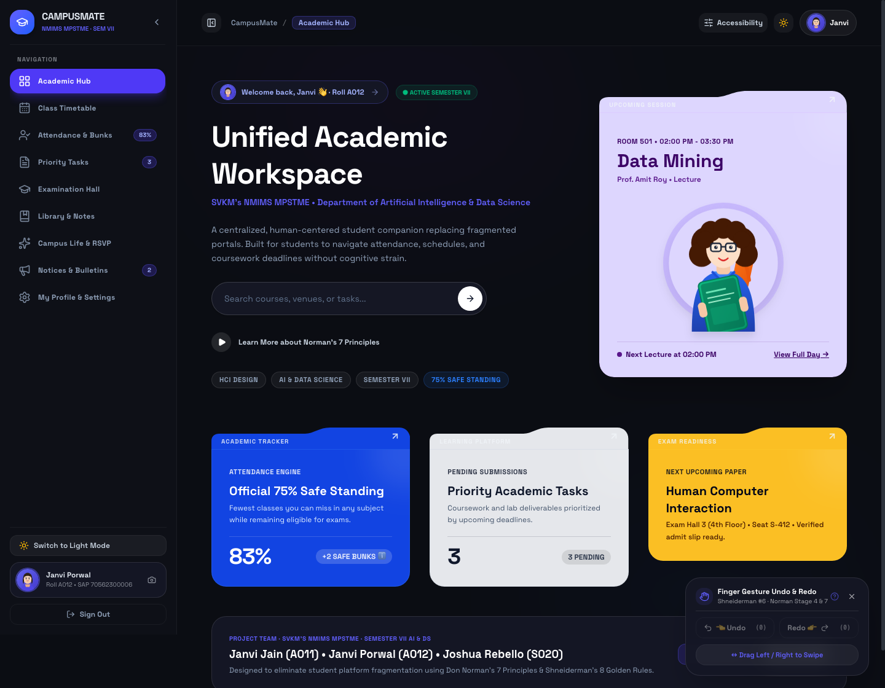
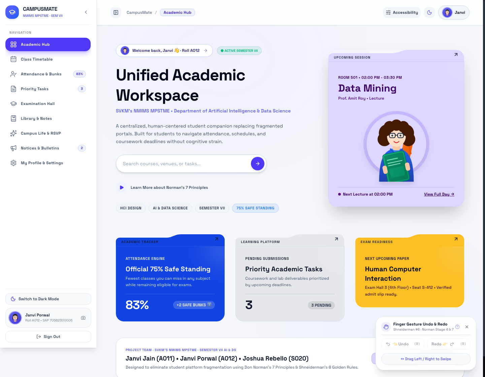
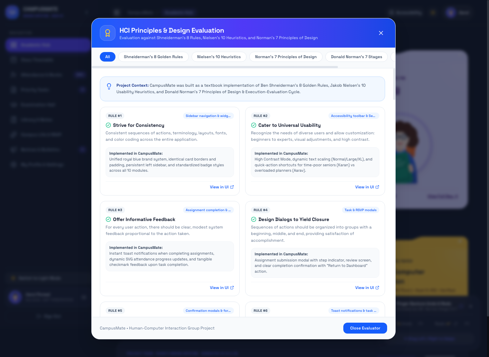
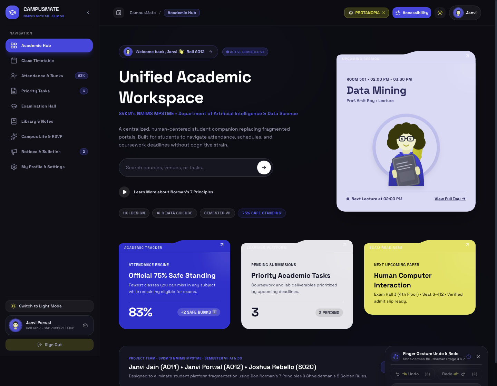
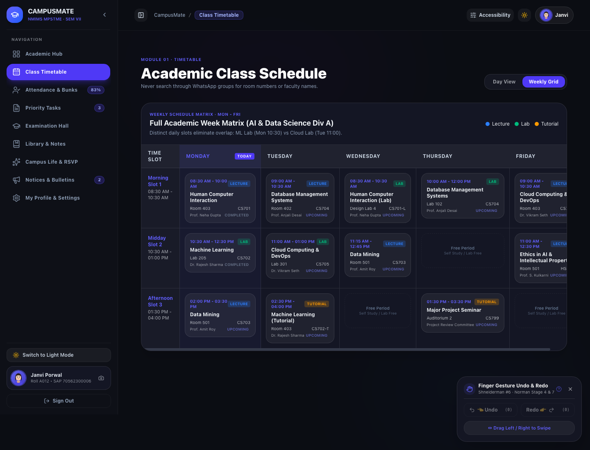
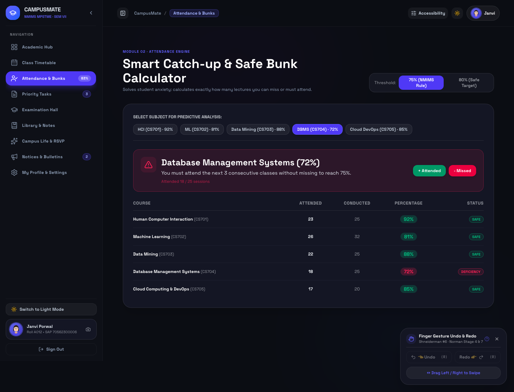
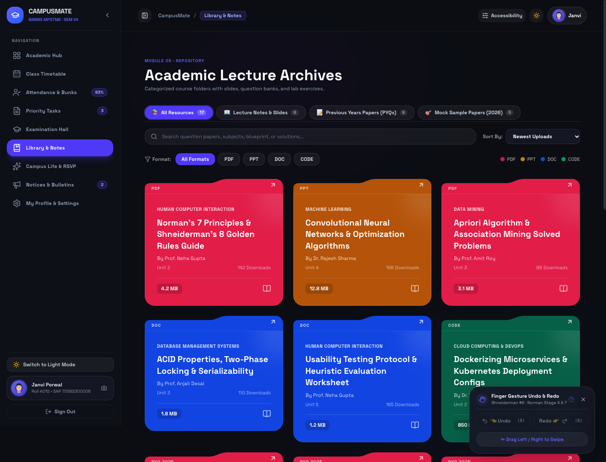
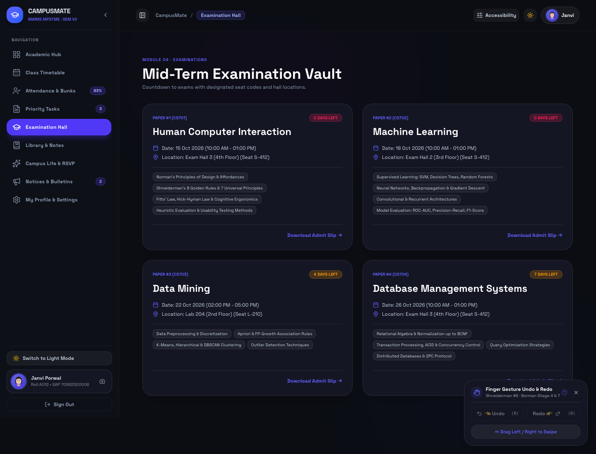
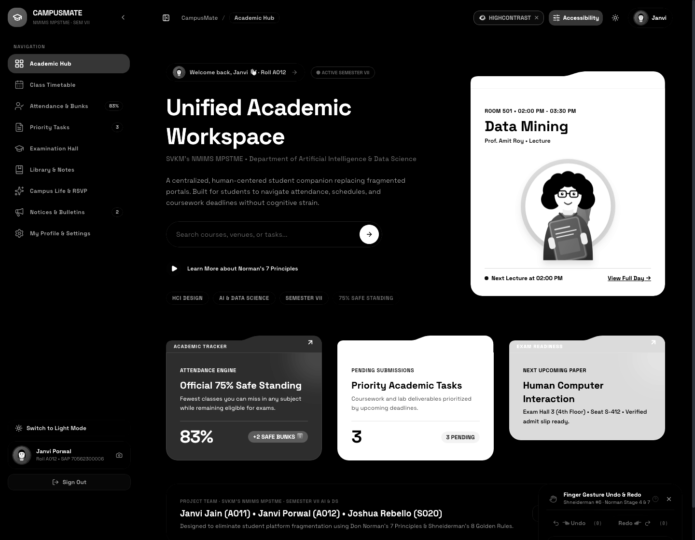
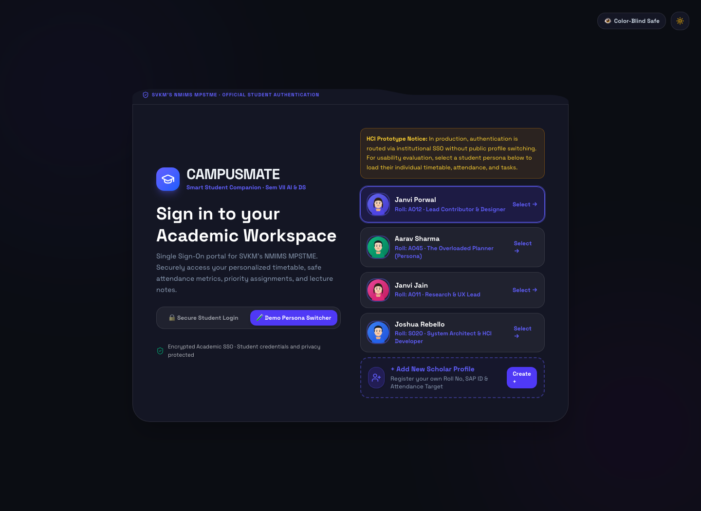

# CampusMate 🎓
### A Human-Centered Smart Student Companion for Academic and Campus Life Management
**SVKM's NMIMS Deemed to be University • MPSTME**  
*Department of Computer Engineering / AI & Data Science (Semester VII)*

[](https://react.dev/)
[](https://www.typescriptlang.org/)
[](https://vitejs.dev/)
[](https://tailwindcss.com/)
[](#-human-computer-interaction-hci-frameworks--compliance)

---

## 👥 Project Team
| Group Member | Roll No. | SAP ID | Role |
| :--- | :--- | :--- | :--- |
| **Janvi Jain** | A011 | 70562300089 | Research & UX Lead |
| **Janvi Porwal** | A012 | 70562300006 | Lead Designer & Contributor |
| **Joshua Rebello** | S020 | 70562200090 | System Architect & HCI Developer |

---

## 📌 Problem Definition & Motivation
College students currently manage university academics across 6+ fragmented and disconnected touchpoints:
1. **College ERP (Student Portal)**: Clunky, unoptimized for mobile, slow session logins.
2. **LMS (Blackboard / Moodle)**: Deep nesting of course syllabi and assignment dropboxes.
3. **WhatsApp Groups & Class Chats**: Critical announcements quickly buried beneath casual conversation.
4. **Scattered Email Inboxes**: Important notices lost amidst generic institutional newsletters.
5. **Physical Notice Boards & Class Rep messages**: Unsynchronized and prone to missed deadlines.

This causes extreme cognitive fatigue, unexpected attendance eligibility crises (<75% mandatory threshold), and last-minute panic before exams.

**CampusMate** resolves this by replacing reactive checking with an unified, human-centered, and accessible dashboard engineered specifically around proven Human-Computer Interaction (HCI) methodologies.

---

## 📸 Interface Gallery & Dashboard Showcase

| 🌙 Unified Academic Hub (Dark Theme) | ☀️ Unified Academic Hub (Light Theme) |
| :---: | :---: |
|  |  |

| 🏆 Interactive HCI Principles Evaluation | 👁️ Color-Blind Safe Mode (Protanopia) |
| :---: | :---: |
|  |  |

| 📅 Weekly Schedule Matrix (Mon–Fri Grid) | 🧮 Smart Catch-up & Safe Bunk Calculator |
| :---: | :---: |
|  |  |

| 📚 Stepped Folders Library (Solved PYQs & Mocks) | 🎟️ Digital Examination Hall Pass & QR |
| :---: | :---: |
|  |  |

| 🎯 High-Contrast Monochrome Mode | 👥 Student Portal & New User Registration |
| :---: | :---: |
|  |  |

---

## 🧠 Human-Computer Interaction (HCI) Frameworks & Compliance

CampusMate was built from the ground up to demonstrate mastery of classical and modern HCI principles. Click the **"HCI Principles"** button on the top navigation bar inside the app to inspect the live interactive mapping matrix.

### 1. Donald Norman's Model: The Seven Stages of Action
CampusMate structures the user journey around the **Execution-Evaluation Cycle**:
* **Goal Establishment**: *"I need to ensure I don't get debarred from my semester exams."*
* **Intention Formation**: *"I will verify my lowest subject attendance and check my safe bunks."*
* **Action Specification**: Clear, high-contrast, one-click attendance filters and calculation buttons.
* **Execution**: Single-click toggle between standard 75% and safe 80% attendance targets.
* **Perception of System State**: Real-time animated circular progress rings with distinct color bands.
* **Interpretation of System State**: Distinct tags showing `+2 SAFE BUNKS` with tooltip explanations (`Fewest classes you can miss in any subject before breaching criteria`).
* **Evaluation with Respect to Goal**: Immediate visual confirmation that attendance meets university eligibility.
* **Minimizing the Gulf of Execution**: Obvious, discoverable affordances and visible keyboard / gesture shortcuts.
* **Minimizing the Gulf of Evaluation**: Instant, real-time feedback with zero hidden latency and consistent data sources.

---

### 2. Shneiderman's 8 Golden Rules of Interface Design
1. **Strive for Consistency**: Standardized typography, uniform elevation, persistent sidebar navigation, and predictable card designs across all modules.
2. **Cater to Universal Usability**: Color-blind safe palettes (Protanopia, Deuteranopia, Tritanopia, Monochrome), OpenDyslexic font support, text size scaling (100%, 115%, 130%), and reduced motion toggles.
3. **Offer Informative Feedback**: Reactive toast notifications, live attendance progress gauges, and celebratory feedback upon task completion.
4. **Design Dialogs to Yield Closure**: Dedicated modal workflows for submitting assignments and RSVPing to campus events with explicit confirmation screens.
5. **Prevent Errors**: Destructive actions require secondary confirmation; form fields validate in real time with helpful inline hints.
6. **Permit Easy Reversal of Actions (Undo/Redo)**: Reversible task toggles with a configurable undo toast window, full undo/redo action history, and **Finger Gesture Controls**.
7. **Support Internal Locus of Control**: Flexible controls allow students to customize attendance targets, switch timetable views (Daily vs Mon–Fri Matrix), and toggle accessibility features.
8. **Reduce Short-Term Memory Load**: Centralized dashboard aggregates upcoming classes, priority deadlines, solved PYQs, and countdown timers on a single screen without requiring recall.

---

### 3. Jakob Nielsen's 10 Usability Heuristics
* **Visibility of System Status**: Live indicator tags showing current class sessions and unified exam countdowns.
* **Match Between System and Real World**: Academic terminology students recognize (`Bunks`, `Internal CA`, `End Sem`, `Faculty Cabins`, `Credits`).
* **User Control and Freedom**: Clear exit routes on all dialogs, breadcrumb navigation, and universal Undo/Redo.
* **Consistency and Standards**: Familiar web application conventions and standard keyboard shortcuts (`Ctrl+Z`, `Ctrl+Y`, `Cmd+K`).
* **Error Prevention**: Safe defaults, non-destructive initial states, and constraint-based input masks.
* **Recognition Rather Than Recall**: Searchable library with category chips, recent notes, and stepped folder structures.
* **Flexibility and Efficiency of Use**: Power-user keyboard shortcuts and custom hand gesture controls for quick navigation.
* **Aesthetic and Minimalist Design**: Clean UI hierarchy with high content-to-chrome ratio; avoids decorative clutter.
* **Help Users Recognize, Diagnose, and Recover from Errors**: Plain-language error messages explaining exact corrective steps.
* **Help and Documentation**: Interactive in-app HCI blueprint inspector and context-sensitive helper tooltips.

---

### 4. Norman's 7 Principles of Design
* **Use Knowledge in the World and in the Head**: Combines recognizable icons with concise labels.
* **Simplify Task Structures**: Multi-step workflows broken down into progressive disclosure forms.
* **Make Things Visible**: Critical indicators (e.g. Low Attendance warnings) prominently surfaced.
* **Get the Mappings Right**: Controls directly correspond to the objects they modify.
* **Exploit the Power of Constraints**: Disables invalid actions (e.g. setting alerts on past classes).
* **Design for Error**: Resilient data stores with automatic rollback and undo mechanisms.
* **When All Else Fails, Standardize**: Uses standard navigation drawer, header breadcrumbs, and floating action button patterns.

---

## 🌟 Key Application Features

### 🖐️ Finger Gesture Engine for Undo & Redo
- **Touch & Trackpad Gestures**:
  - **Swipe Left (3 fingers)**: Instantly **Undo** the last action.
  - **Swipe Right (3 fingers)**: Instantly **Redo** the previous action.
  - Two-finger rapid swipe fallback for mobile touchscreens.
- **Gesture Bar Overlay**: Real-time visual indicator showing recognized touch points, swipe vector, and execution state.
- **Physical Keyboard Fallback**: Full compatibility with `Cmd/Ctrl + Z` and `Cmd/Ctrl + Shift + Z / Ctrl + Y`.

### 👁️ Universal Accessibility & Vision Modes
- **Color-Blind Safe Simulation & Correction**:
  - **Normal Vision**
  - **Protanopia** (Red-weak / Red-blind)
  - **Deuteranopia** (Green-weak / Green-blind)
  - **Tritanopia** (Blue-weak / Blue-blind)
  - **Monochrome / Achromatopsia** (High contrast greyscale)
- **Dyslexia-Friendly Typography**: Toggleable OpenDyslexic typeface for enhanced reading comprehension.
- **Reduce Motion**: Disables micro-animations and physics-based transitions for users with vestibular sensitivity.
- **Contrast & Font Scaling**: Standard, High Contrast, and 3-step font sizing.

### 📅 Timetable & Attendance Engine
- **Weekly Mon–Fri Time Matrix Grid**: Clean, conflict-free matrix view mapping lectures, labs, and breaks.
- **Safe Bunk Calculator**: Accurately computes remaining allowable leaves per course without dropping below 75% or 80%.
- **Live Class Detection**: Dynamic indicator for active lectures based on real-time clock synchronization.

### 📚 Stepped Folders Library with Solved PYQs & Mock Papers
- **Hierarchical Course Folders**: Machine Learning, Cloud Computing, HCI, and Information Security.
- **Solved Previous Year Question Papers (PYQs)**: 2023, 2024, and 2025 semester end exam solutions with step-by-step marking schemes.
- **2026 Sample Mock Examination Papers**: Curated mock test papers with blueprints and question distribution.
- **Instant Search & Filter**: Filter by semester, file type (PDF, DOCX, Code), or subject tag.

### ⏱️ Unified Exam Hall
- **Single Source of Truth**: Unified countdown clocks eliminate countdown contradictions across dashboard, profile, and exam cards.
- **Seat Allocation & Hall Ticket QR**: Digital exam hall passes with room number, bench assignment, and verification tokens.

### 👤 User Persona Switcher & Onboarding
- **Pre-configured Demo Personas**:
  - **Aarav Sharma** (AI & DS, Sem VII - High Achiever)
  - **Priya Patel** (Computer Eng, Sem VII - Attendance Recovery Mode)
  - **Rohan Verma** (IT, Sem VII - Sports Quota & Extracurriculars)
- **Add New User Workflow**: Interactive modal to create and register custom student profiles with custom SAP IDs, roll numbers, and avatars.

---

## 💻 Tech Stack & Architecture

- **Core Framework**: [React 19](https://react.dev/) + [TypeScript](https://www.typescriptlang.org/) (Strict Mode)
- **Build Tool**: [Vite 8](https://vitejs.dev/) with lightning-fast Hot Module Replacement (HMR)
- **Styling**: [Tailwind CSS v4](https://tailwindcss.com/) with custom CSS custom property tokens
- **Icons**: [Lucide React](https://lucide.dev/)
- **Micro-Interactions**: [Canvas Confetti](https://www.npmjs.com/package/canvas-confetti)
- **Typography**: Plus Jakarta Sans & OpenDyslexic
- **State Management**: React Context with persistent LocalStorage synchronizer

---

## 🚀 Getting Started

### Prerequisites
- [Node.js](https://nodejs.org/) (v18.0.0 or higher recommended)
- `npm` or `pnpm`

### Installation
1. Clone the repository:
   ```bash
   git clone https://github.com/mozartreject/campusmate.git
   cd campusmate
   ```

2. Install dependencies:
   ```bash
   npm install
   ```

3. Start the local development server:
   ```bash
   npm run dev
   ```

4. Open your browser and navigate to:
   ```
   http://localhost:5173
   ```

### Production Build
To create an optimized production build:
```bash
npm run build
```

To preview the production build locally:
```bash
npm run preview
```

---

## 📄 Academic Integrity & License
Developed as part of the **Human-Computer Interaction (HCI)** curriculum at SVKM's NMIMS Indore.  
Licensed under the [MIT License](LICENSE).
